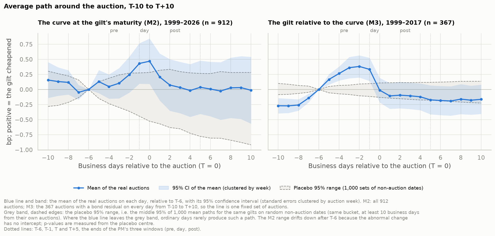
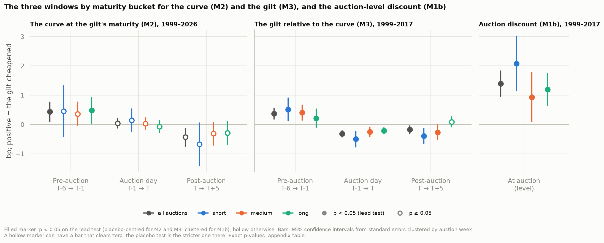
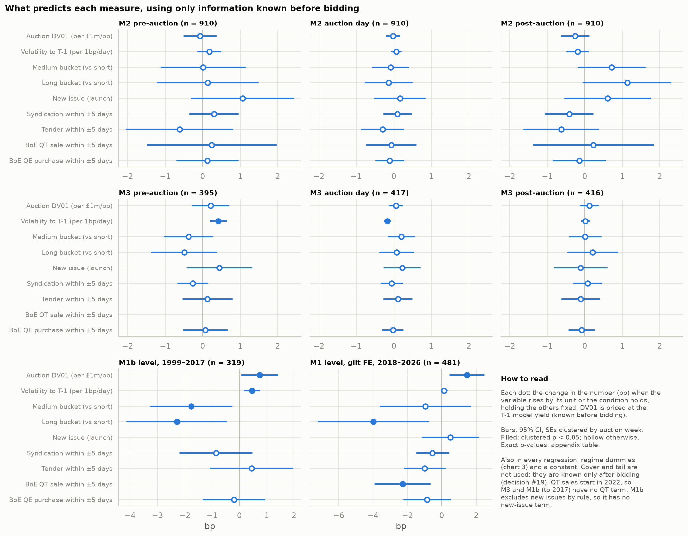
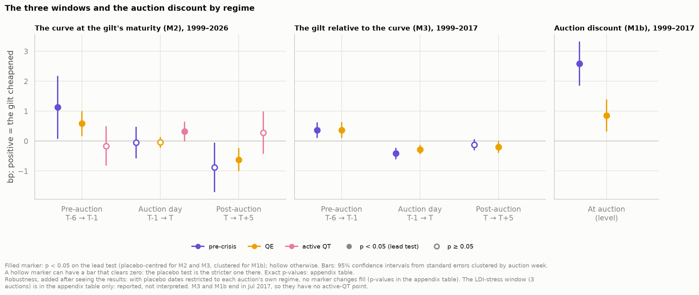

# Gilt Auction Concessions, 1999–2026: How Much Do Auctioned Gilts Cheapen, and Where?

Nithin Premkumar · 22 October 2026

## Summary

Across 912 conventional gilt auctions from May 1999 to September 2026, the auctioned gilt cheapens slightly before the auction, the auction clears at a small discount, and most of the move reverses within a day.

1. **The gilt cheapens into the auction, then mostly recovers.** In the two weeks before an auction the gilt cheapens by **0.60bp** relative to the yield curve (1999–2017, bond-level data; p < 0.001). About three-quarters of that build-up reverses by the day after the auction.
2. **Auctions clear cheap, and bigger auctions clear cheaper.** The average auction yield is **1.39bp** above the gilt's normal level relative to the curve (1999–2017). Each extra £1m per basis point of auction DV01 adds about **0.7bp**.
3. **The effect is in the bond, not the curve.** On auction day the gilt richens against the curve by 0.32bp while the curve itself does not move. The curve shows the pre-auction build-up clearly only at the long end.
4. **Volatility and size drive it; nearby supply does not.** Higher rate volatility predicts a larger build-up, and stronger-than-usual auction demand goes with a smaller discount. Syndications, tenders and Bank of England operations in the same week do not reliably change it.
5. **Concessions have shrunk.** The auction discount fell from **2.59bp** before the financial crisis to **0.86bp** in the QE era. There is no robust evidence that quantitative tightening or the post-2022 retreat of LDI funds has pushed it back up.

These effects are statistically clear but small: a fraction of a typical week's move in gilt yields. They describe the average auction, not a forecast for the next one.

## Why it matters

A **concession** is the temporary cheapening of a bond around new supply: buyers who absorb a large, known block of a gilt want paying for carrying its rate risk until they can sell it on. This study measures how large that concession is for UK gilts, where it shows up, what drives it, and whether it has changed across the pre-crisis, quantitative easing (QE) and quantitative tightening (QT) eras.

Three features of today's market make the question timely:

- **Supply is large.** The UK Debt Management Office (DMO) plans £252.1bn of gilt sales in 2026-27, £179.6bn of it through 53 auctions ([DMO remit](https://www.dmo.gov.uk/media/gnffn5rz/sa030326.pdf)).
- **The investor base has changed.** After the September 2022 crisis, liability-driven investment (LDI) funds cut leverage, and the Bank of England sold gilts under QT from November 2022 until it paused sales in September 2026 ([Bank of England](https://www.bankofengland.co.uk/markets/market-notices/2026/asset-purchase-facility-gilt-sales-market-notice-17-september-2026)).
- **Index rules fix the timing for passive funds.** The FTSE Actuaries UK Gilts indices add auctioned stock at the close on auction day ([Ground Rule 7.1.1](https://www.lseg.com/content/dam/ftse-russell/en_us/documents/ground-rules/ftse-actuaries-uk-gilts-index-series-ground-rules.pdf)), so a fund that tracks them must decide whether to buy before, at or after the auction.

The pattern itself is well documented: prices fall before US Treasury auctions and recover after (Lou, Yan & Zhang, 2013), and earlier studies found similar effects in gilts (Ahmad & Steeley, 2008; Fuhrer & Giese, 2021). What has been missing is a free, systematic and up-to-date measure for gilts that spans QE, the LDI crisis and QT.

## Finding 1: the gilt cheapens into the auction, then mostly recovers

Measured against the Bank of England yield curve, the auctioned gilt cheapens by **0.60bp** from ten business days before the auction (T-10) to the day before (T-1), then gives back about three-quarters of that by the day after.

| Window | The gilt vs the curve (M3, 1999–2017) | The curve itself (M2, 1999–2026) |
| --- | --- | --- |
| Build-up, T-10 → T-1 | **+0.60bp** (p < 0.001) | +0.28bp (p 0.22) |
| Pre-auction, T-6 → T-1 | **+0.37bp** (p < 0.001) | **+0.43bp** (p 0.008) |
| Auction day, T-1 → T | **−0.32bp** (p < 0.001) | +0.04bp (p 0.35) |
| Post-auction, T → T+5 | **−0.18bp** (p 0.004) | −0.43bp (p 0.074) |
| Net, T-10 → T+1 | +0.16bp (p 0.012) | |

*Positive = the gilt cheapened (its yield rose). p-values from 1,000 sets of random non-auction dates. The net move is not significant with standard errors clustered by auction week (p 0.15).*

The build-up begins around T-8, close to when the DMO confirms each auction's size (about a week ahead), and it appears in every maturity bucket: **+1.03bp** for short gilts, **+0.51bp** for medium and **+0.32bp** for long (all p < 0.001 against random dates; for long gilts the clustered p is 0.08). Of the 0.60bp build-up, 0.44bp (73%) has reversed by T+1, and the gilt keeps drifting back over the following week.

Auctions close mid-morning, so the close on auction day is already after the auction. The fall on auction day therefore means the gilt was cheapest for those who bought *in* the auction, and had richened by the close.

*Note:* the T-10 → T-1 and T-10 → T+1 windows were added after inspecting chart 1. The pre-specified window, T-6 → T-1, points the same way (+0.37bp, p < 0.001).

## Finding 2: auctions clear cheap, and bigger auctions clear cheaper

The average accepted auction yield sits **1.39bp** above the gilt's normal level relative to the curve (95% CI 0.96 to 1.82bp; 319 auctions, 1999–2017).

| Bucket | Auction discount (M1b) | Auctions |
| --- | --- | --- |
| Short (under 7 years) | 2.08bp (CI 1.15 to 3.01) | 98 |
| Medium (7–15 years) | 0.93bp (CI 0.09 to 1.77) | 89 |
| Long (over 15 years) | 1.19bp (CI 0.64 to 1.75) | 132 |
| All | **1.39bp** (CI 0.96 to 1.82) | 319 |

"Normal level" matters. Many gilts trade persistently rich or cheap to the fitted curve, so the measure (M1b) subtracts each gilt's own average gap to the curve over T-25 to T-6 before comparing it with the auction yield. Without that adjustment the same auctions average 1.92bp, overstating the discount by about 0.5bp. M1b includes the pre-auction build-up from Finding 1 as well as a discount at the auction itself.

**Size, measured as risk, matters.** Holding volatility, maturity and nearby supply fixed, each extra £1m per basis point of auction DV01 adds **0.74bp** to the discount (p 0.028). For 2018–2026, where only comparisons within the same gilt are possible, the effect is **1.46bp** per £1m/bp (p 0.004). Bigger blocks of duration need a bigger discount to be absorbed.

Two features of the market explain why auctions clear cheap. Conventional gilt auctions are multiple-price, so bidders shade their bids to avoid overpaying relative to other winners. And the gilt-edged market makers (GEMMs) are obliged to bid, so they bid low enough to be paid for warehousing stock they may not want.

## Finding 3: the auction-day move is in the bond; the curve sees the build-up at the long end

On auction day the gilt richens against the curve by **0.32bp** (p < 0.001) while the curve at its maturity does not move (+0.04bp, p 0.35): the reversal is specific to the auctioned gilt, not its sector.

The two measures answer different questions. The curve (M2) is fitted to dozens of gilts, so one gilt moving barely shifts it; it captures moves of a whole maturity sector. The gilt's gap to the curve (M3) captures moves specific to that one bond.

| Pre-auction, T-6 → T-1 | The curve (M2) | The gilt vs the curve (M3) |
| --- | --- | --- |
| Short | +0.45bp (p 0.25) | +0.51bp (p < 0.001) |
| Medium | +0.36bp (p 0.053) | +0.40bp (p < 0.001) |
| Long | **+0.48bp (p 0.004)** | +0.21bp (p 0.005) |

*p-values against random dates. With clustered standard errors the long-bucket gilt move (+0.21bp) is not significant (p 0.19).*

Only at the long end does the build-up show clearly on the curve, and over the longer T-10 → T-1 window it shows only there (+0.63bp, p 0.006). A long auction is a large block of duration, enough to cheapen the whole long sector; short and medium auctions cheapen the individual bond.

The bond-level numbers are, if anything, understated. The Bank of England fits its curve partly to the auctioned gilt, so the curve bends slightly towards the gilt when it moves, shrinking the measured gap. That bias pulls estimates towards zero; it cannot create an effect or reverse its sign.

## Finding 4: volatility and size drive it; nearby supply does not

Using only information available before bidding, rate volatility predicts a larger build-up and a larger auction discount, and auction size in DV01 predicts a larger discount; other supply in the same week does not reliably matter.

| Predictor (known before bidding) | Effect | p |
| --- | --- | --- |
| Volatility → pre-auction build-up (gilt vs curve) | +0.42bp per 1bp/day of volatility | < 0.001 |
| Volatility → auction-day move (gilt vs curve) | −0.17bp per 1bp/day (a larger reversal) | < 0.001 |
| Volatility → auction discount (M1b) | +0.46bp per 1bp/day | 0.001 |
| Auction DV01 → auction discount (M1b) | +0.74bp per £1m/bp | 0.028 |

*Volatility is the 20-day realised volatility of the curve at the gilt's maturity, measured to T-1.*

Syndications, tenders, Bank of England QE purchases and new issues show no reliable effect on any measure. One coefficient runs against expectations: in 2018–2026, auctions in weeks with a Bank of England QT sale cleared about 2.3bp *less* cheaply than other auctions of the same gilt (p 0.006). It has no clear explanation and rests on a short period, so it is reported but not interpreted.

On the day itself, demand matters. In a separate specification that adds information only known after bidding, a higher-than-usual bid-to-cover ratio goes with a smaller auction discount (M1b, 1999–2017) and with stronger richening on auction day, in both the gilt and the curve. It shows no effect after the auction, or within gilts in 2018–2026.

This matches a simple inventory-risk view: the discount a buyer needs grows with the risk being absorbed, which rises with both the size of the block and the volatility of rates.

## Finding 5: concessions have shrunk, with no robust sign of a reversal under QT

The auction discount fell from **2.59bp** before the financial crisis to **0.86bp** in the QE era (holding size, volatility and maturity fixed, the QE-era discount is 1.8bp lower, p < 0.001), and there is no robust evidence that QT or the retreat of LDI funds has pushed it back up.

| Regime | Auction discount (M1b) | Curve, pre-auction (M2) | Curve, auction day (M2) | Gilt build-up, T-10 → T-1 (M3) |
| --- | --- | --- | --- | --- |
| Pre-crisis (Nov 1998 – 2008) | 2.59bp | +1.13bp (p 0.003) | −0.05bp | +0.92bp |
| QE (2009 – Oct 2022) | 0.86bp | +0.59bp (p 0.013) | −0.04bp | +0.48bp |
| Active QT (Nov 2022 – Sep 2026) | not measurable | −0.16bp (p 0.65) | **+0.32bp (p 0.030)** | not measurable |

Every measure in the table is smaller in the QE era than before the crisis (the shorter T-6 → T-1 gilt window is the same in both, +0.37bp), and the cheapening also reversed more completely: the net move to T+1 was +0.41bp pre-crisis (p 0.014) against +0.07bp under QE (not significant). One possible reason is that the Bank of England was a large buyer during QE, giving dealers somewhere to offload stock; lower volatility for much of the period may also have helped. Neither explanation is tested here.

For the QT era only curve-based measures exist, because free bond-level prices stop in July 2017. On the curve, the pre-auction build-up disappears under QT, while the auction day shows a small cheapening (+0.32bp, p 0.030 against random dates; p 0.10 with Newey-West errors), which may mean the pattern has moved later. A positive QT coefficient in the within-gilt auction-level regression (+6.2bp, p 0.010) holds in most robustness checks but falls to +4.2bp (p 0.17) when February–October 2022 is excluded, so it is not robust. The few long auctions since 2022 are also a selected sample, because most long supply has moved to syndications. The LDI-stress window (23 September – 14 October 2022) has only three auctions and is reported in the data but not interpreted, as are the two auctions held after the September 2026 decision to pause QT sales.

## What it means for investors

On average, the cheapest point to buy an auctioned gilt is in the auction itself, but the saving is small next to the rate risk of trying to time it.

- **Index trackers.** For funds tracking the FTSE Actuaries indices, which add auctioned stock at the auction-day close, buying in the auction is both index-neutral and, on average, the cheapest choice. Buying early pays the build-up and runs an overweight; buying after pays the reversal.
- **Active managers.** The pattern is too small to trade on its own, but it is a reason to source new supply through the auction (bidding via a GEMM) rather than the secondary market, especially for large auctions and in volatile weeks.
- **The issuer.** The discount is a cost of funding. It has fallen substantially since before the financial crisis and shows no robust rise under QT.

**In pounds.** For an illustrative £100m purchase (DV01 about £30k per bp for a 3-year gilt, £74k for a 10-year and £140k for a 30-year, at current yield levels):

| Bucket | Build-up avoided by not buying at T-10 | Auction discount vs the gilt's normal level |
| --- | --- | --- |
| Short (3-year) | 1.03bp ≈ £31k | 2.08bp ≈ £62k |
| Medium (10-year) | 0.51bp ≈ £38k | 0.93bp ≈ £69k |
| Long (30-year) | 0.32bp ≈ £45k | 1.19bp ≈ £167k |

Against that, the typical daily standard deviation of gilt yields has been about 4bp since 1999 and about 5.4bp in the QT era (median 20-day realised volatility of the Bank of England curve at 25 years). Positioning nine days early in a £100m 30-year purchase therefore carries roughly **£1.7m to £2.3m** of one-standard-deviation risk for an expected gain of about £45k. Buying at the auction is the sensible default; trying to time it is not.

An auction bid is not guaranteed a full fill (bids at the lowest accepted price are often scaled back), and the post-auction option facility is open only to successful bidders.

## Limitations

The strongest, bond-level evidence covers 1999–2017; the QT-era picture rests on the yield curve alone.

| Limitation | Affects | Likely direction |
| --- | --- | --- |
| No free bond-level gilt prices after July 2017 | Findings 1, 2 and 5 for the QT era | Unknown: QT-era bond effects are unmeasured |
| The Bank of England curve is fitted partly to the auctioned gilt | Findings 1 and 3 | Towards zero: bond-level effects are at least as large as shown |
| The curve stops at 25 years before 2016 and 40 years after; longer cash flows are extrapolated | Auction-level measures for the longest gilts | Results checked by dropping auctions more than 5 years beyond the curve |
| Few, selected long auctions since 2022 | Finding 5 | Likely to understate QT-era long-end concessions |
| Two event windows added after inspecting the data | Finding 1 | Labelled; the pre-specified window gives the same direction |
| No bid-offer data | What it means for investors | Secondary-market costs would favour the auction further |
| Index-linked gilts excluded | All findings | Results apply to conventional gilts only |

The results are averages over hundreds of auctions, not forecasts. They establish the market pattern; the explanations offered (inventory risk, bid shading, the Bank's role under QE) are consistent with it but not separately tested.

## Data and method

Each auctioned gilt is priced off the Bank of England's daily nominal spot curve; the concession is the gap, in basis points of yield, between where the gilt clears or trades and that model value.

**Sample.** 912 conventional gilt auctions, 26 May 1999 – 29 September 2026 (80 new issues, 832 reopenings); 328 index-linked auctions excluded. The sample window opens on 1 November 1998, when gilts moved to actual/actual accrued interest; the first auction in it is on 26 May 1999. Auction counts were reconciled against the DMO's published annual totals.

| Measure | Definition | Coverage |
| --- | --- | --- |
| M1 | Average accepted auction yield − the gilt's model yield off the previous day's curve | 1999–2026 (after 2017, used only for comparisons within the same gilt) |
| M1b | M1 minus the gilt's own average gap to the curve over T-25 to T-6 | 1999–2017, 319 auctions |
| M2 | Abnormal change in the curve at the gilt's maturity, T-10 to T+10 | 1999–2026, 912 auctions |
| M3 | Change in the gilt's own gap to the curve, T-10 to T+10 | 1999–2017, about 400 auctions |

**Abnormal changes (M2).** The control is the average move of the curve at maturities more than three years away from the auctioned gilt, scaled by a beta estimated over T-120 to T-21, so that the auctioned sector's own move is not subtracted from itself.

**Validation.** The pricer reproduces 99.98% of 135,094 DMO reference prices (single-dated conventional gilts, November 2002 – July 2017) to within 0.0001; all 27 exceptions are traced to errors in the DMO files. Every auction's average accepted yield reprices to the DMO's published average price.

**Inference.** For the event-path measures (M2, M3), the lead test compares each average with 1,000 sets of random non-auction dates (same gilt, same maturity bucket). M1b averages and all regressions use standard errors clustered by auction week, because event windows overlap, and all 95% confidence intervals use clustered standard errors. Where the two tests disagree, the report says so. Regressions use only information known before bidding unless stated. Robustness checks: an alternative control, dropping February–October 2022, dropping auctions far beyond the curve, and alternative volatility and size definitions.

**Regimes.** Pre-crisis (Nov 1998 – Dec 2008); QE (2009 – October 2022, including the months of passive QT and excluding the LDI-stress window); LDI stress (23 Sep – 14 Oct 2022); active QT (1 Nov 2022 – 16 Sep 2026); after the decision to pause QT sales (from 17 Sep 2026, two auctions, descriptive only).

**Pricing conventions.** Settlement T+1 on UK business days; actual/actual accrued interest; ex-dividend seven UK business days before the coupon, with settlement on the ex-dividend date still cum-dividend; irregular first coupons and when-issued trades priced to the tranche's issue date.

**Authorship.** Research design, methodological decisions and interpretation are the author's. Data processing, code and drafting were AI-assisted. Every methodological decision is recorded, with its reason, in the project's decision log.

Code, decision log and full results table: https://github.com/nithinpremkumar1999/gilt-auction-concession.git

## Sources

**Data**

- [Bank of England, UK yield curves (daily nominal spot curve)](https://www.bankofengland.co.uk/statistics/yield-curves)
- [UK DMO, historical reference prices and yields, 1998–2017](https://www.dmo.gov.uk/data/gilt-market/historical-prices-and-yields/)
- [UK DMO, results of gilt operations (auctions D2.1A, syndications, tenders)](https://www.dmo.gov.uk/data/gilt-market/results-of-gilt-operations/)
- [UK DMO, gilts in issue and issuance history (D1A, D1C, D2.1E)](https://www.dmo.gov.uk/data/gilt-market/gilts-in-issue/)
- [Bank of England, asset purchase and sale operation results](https://www.bankofengland.co.uk/markets/bank-of-england-market-operations-guide/results-and-usage-data)

**Context**

- [UK DMO, financing remit 2026-27](https://www.dmo.gov.uk/media/gnffn5rz/sa030326.pdf)
- [Bank of England, APF gilt sales market notice, 17 September 2026](https://www.bankofengland.co.uk/markets/market-notices/2026/asset-purchase-facility-gilt-sales-market-notice-17-september-2026)
- [FTSE Russell, FTSE Actuaries UK Gilts Index Series ground rules](https://www.lseg.com/content/dam/ftse-russell/en_us/documents/ground-rules/ftse-actuaries-uk-gilts-index-series-ground-rules.pdf)

**Literature**

- Lou, D., Yan, H. and Zhang, J. (2013), Anticipated and repeated shocks in liquid markets, *Review of Financial Studies*.
- [Ahmad, M. and Steeley, J. (2008), Secondary market pricing behaviour around UK bond auctions, *Applied Financial Economics*](https://ideas.repec.org/a/taf/apfiec/v18y2008i9p691-699.html)
- [Fuhrer, L. and Giese, J. (2021), Gilt auctions and secondary market dynamics, *Finance Research Letters*](https://ideas.repec.org/a/eee/finlet/v38y2021ics1544612319309134.html)
